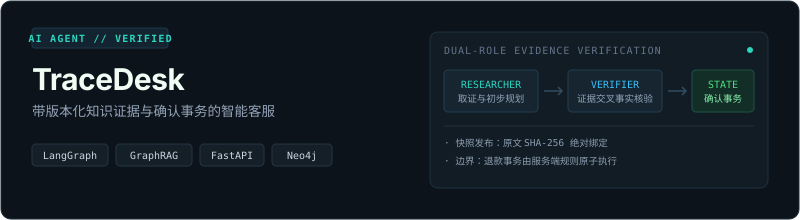
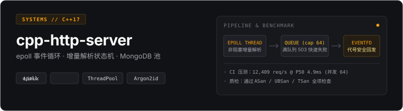
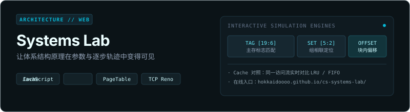
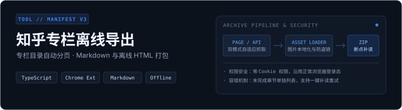
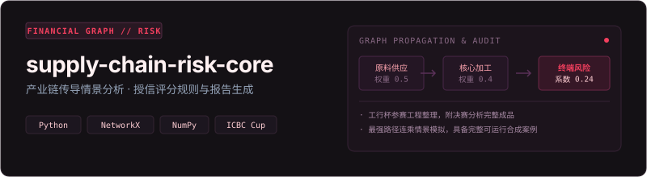
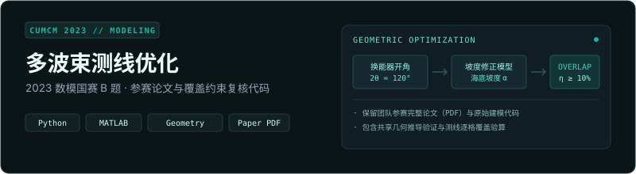

你好，我是 Hokkaido。写后端，也做系统底层、可验证 AI Agent 与数据建模。追求明确的架构边界、确定性的状态转移与可复现的工程证据。

## 精选项目

<table>
<tr>
<td width="50%" valign="top">

<h3>TraceDesk · 智能客服 Agent</h3>

带版本化资料库、证据检索和确认流程的 AI 客服。支持 TXT/Markdown/PDF 证据挂载与 SHA-256 原文锚定，LangGraph 双角色验证与单角色基线评测；退款状态流转由服务端确定性规则与事务保障。

<code>FastAPI</code> <code>LangGraph</code> <code>GraphRAG</code> <code>Neo4j</code> <code>TypeScript</code>

<a href="https://github.com/Hokkaidoooo/tracedesk/blob/main/docs/architecture.md">架构与模型边界</a> · <a href="https://github.com/Hokkaidoooo/tracedesk/blob/main/docs/validation-v0.2.md">评测与验证报告</a> · <a href="https://github.com/Hokkaidoooo/tracedesk/releases/tag/v0.2.0">v0.2.0 发布包</a>

</td>
<td width="50%" valign="top">

<h3>C++ HTTP 服务器</h3>

Linux C++17 服务端原型：非阻塞 epoll 统一调度、有界工作队列与工作线程池。通过 ASan/UBSan 与 TSan 内存安全检查；集成 MongoDB 连接池，并在 CI 实跑 <code>hey</code> 压测（达 12,409 req/s），深入剖析线程调度瓶颈。

<code>C++17</code> <code>epoll</code> <code>ThreadPool</code> <code>MongoDB</code> <code>Linux</code>

<a href="https://github.com/Hokkaidoooo/cpp-http-server#结构">请求状态机流程</a> · <a href="https://github.com/Hokkaidoooo/cpp-http-server#性能">压测数据与分析</a> · <a href="https://github.com/Hokkaidoooo/cpp-http-server#linux-构建与验证入口">构建与验证</a>

</td>
</tr>
<tr>
<td width="50%" valign="top">

<h3>系统原理实验室</h3>

体系结构交互式实验套件。在浏览器中可视化观测 Cache 组相联与替换过程（支持同序列 LRU/FIFO 实时对比）、x86-64 四级页表地址翻译与开销、以及 TCP Reno 拥塞避免与丢包恢复。

<code>JavaScript</code> <code>Cache</code> <code>Virtual Memory</code> <code>TCP Reno</code>

<a href="https://hokkaidoooo.github.io/cs-systems-lab/">👉 立即在线体验</a> · <a href="https://github.com/Hokkaidoooo/cs-systems-lab#第一次体验">实验算例与预期结果</a>

</td>
<td width="50%" valign="top">

<h3>知乎专栏离线导出</h3>

Chrome Manifest V3 扩展：将有权阅读的知乎专栏完整归档为 Markdown、离线独立 HTML 与本地图片。自动分页解析全量目录，接口与页面双模式自适应降级；支持断点补读重试，零 Cookie 权限申请。

<code>TypeScript</code> <code>Chrome Extension</code> <code>Manifest V3</code> <code>Markdown</code>

<a href="https://github.com/Hokkaidoooo/zhihu-column-exporter#使用">使用说明</a> · <a href="https://github.com/Hokkaidoooo/zhihu-column-exporter/releases/latest">最新安装包</a> · <a href="https://github.com/Hokkaidoooo/zhihu-column-exporter/blob/main/DEVELOPMENT.md">开发指南</a>

</td>
</tr>
<tr>
<td width="50%" valign="top">

<h3>产业链风险分析与授信研究</h3>

工行杯参赛工程整理出的 Python 风控分析包：串联工商财务特征读取、评分授信规则引擎、产业链最强路径传导情景模拟与报告复现。附带完整的可运行合成数据案例与决赛分析成品。

<code>Python</code> <code>NetworkX</code> <code>图算法</code> <code>数据校验</code>

<a href="https://github.com/Hokkaidoooo/supply-chain-risk-core#运行完整案例">运行示例</a> · <a href="https://github.com/Hokkaidoooo/supply-chain-risk-core#已收录的能力">模块与接口</a>

</td>
<td width="50%" valign="top">

<h3>数学建模国赛 B 题 · 多波束测线</h3>

2023 数模国赛 B 题团队参赛作品：针对复杂海底地形设计多波束测线优化方案。保留完整参赛论文（PDF）与历史代码，补充了海底坡度共享几何推导、逐格覆盖差异与覆盖重叠约束（η ≥ 10%）严格复核。

<code>Python</code> <code>MATLAB</code> <code>数模国赛</code> <code>几何优化</code>

<a href="https://github.com/Hokkaidoooo/cumcm-2023-multibeam/blob/main/paper/cumcm2023-b-paper.pdf">参赛论文 (PDF)</a> · <a href="https://github.com/Hokkaidoooo/cumcm-2023-multibeam#结构">推导与复核代码</a>

</td>
</tr>
</table>

## 其他工程与历史作品

- [MRP 物料需求计划系统](https://github.com/Hokkaidoooo/mrp-system)：按 BOM 拓扑展开需求，FOQ 按整批补足，在一个事务中替换整批结果，包含真实数据库失败回滚与并发重算。
- [校园新闻门户](https://github.com/Hokkaidoooo/campus-news-portal)：Vue 2 门户与 Servlet/JSP 后台，统一连接池、登录控制和 PNG 存储，支持不同部署上下文和端口。
- [南京气象数据可视化](https://github.com/Hokkaidoooo/nanjing-weather-visualization)：离线校验 2023 年 365 天数据，脚本与 Notebook 共用流程生成 61 张图，保留原始数据与历史图片。

## 开源参与

- [context-mode #1251](https://github.com/mksglu/context-mode/issues/1251)：Windows Hook 的依赖重复安装与控制台弹窗问题报告，涉及重试退避与 `windowsHide`。
