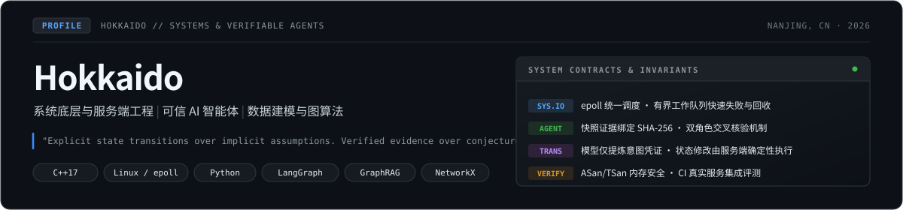
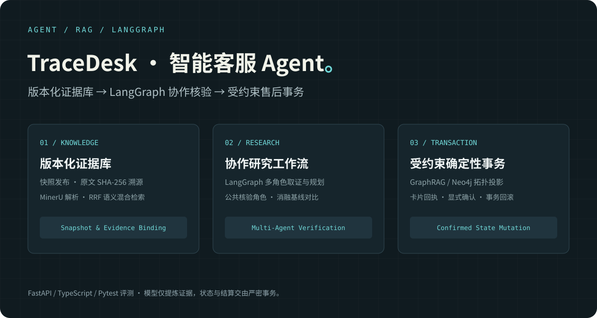
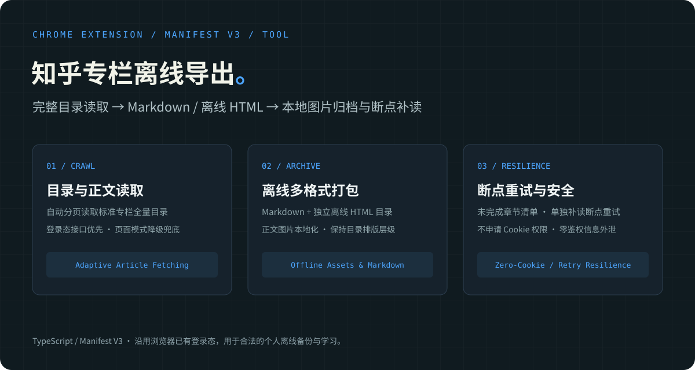

你好，我是 Hokkaido。写后端，也做系统底层、AI Agent 与数据建模。这里放着我的系统实验、服务端项目与工程实践。

## 精选项目

<table>
<tr>
<td width="50%" valign="top">

<h3>TraceDesk · 智能客服 Agent</h3>

带版本化资料库、证据检索和确认流程的 AI 客服。支持 TXT/Markdown/PDF 证据挂载、LangGraph 协作研究与单角色基线评测，退款申请由服务端确定性规则与事务保障。

<code>FastAPI</code> <code>LangGraph</code> <code>GraphRAG</code> <code>AI Agent</code>

<a href="https://github.com/Hokkaidoooo/tracedesk/blob/main/docs/architecture.md">架构与模型边界</a> · <a href="https://github.com/Hokkaidoooo/tracedesk/blob/main/docs/validation-v0.2.md">评测与验证</a> · <a href="https://github.com/Hokkaidoooo/tracedesk/releases/tag/v0.2.0">v0.2.0 发布包</a>

</td>
<td width="50%" valign="top">

<h3>C++ HTTP 服务器</h3>

实现分段 HTTP 请求解析、Argon2id 会话控制和 PNG 原子发布，连接由 epoll 线程管理。真实 MongoDB 集成测试覆盖并发回收，并通过 ASan/UBSan 与 TSan 检查；附真实压测与瓶颈分析。

<code>C++17</code> <code>epoll</code> <code>线程池</code> <code>MongoDB</code>

<a href="https://github.com/Hokkaidoooo/cpp-http-server#结构">请求处理流程</a> · <a href="https://github.com/Hokkaidoooo/cpp-http-server#性能">压测数据与分析</a> · <a href="https://github.com/Hokkaidoooo/cpp-http-server#linux-构建与验证入口">构建与验证</a>

</td>
</tr>
<tr>
<td width="50%" valign="top">

<h3>系统原理实验室</h3>

在浏览器里交互观察 Cache、多级页表和 TCP Reno。支持 LRU/FIFO 同步回放与完整实验链接，结果用手算例、固定种子性质测试与真实浏览器操作核对。

<code>JavaScript</code> <code>Cache</code> <code>虚拟内存</code> <code>TCP</code>

<a href="https://hokkaidoooo.github.io/cs-systems-lab/">在线体验</a> · <a href="https://github.com/Hokkaidoooo/cs-systems-lab#第一次体验">操作示例与预期结果</a>

</td>
<td width="50%" valign="top">

<h3>知乎专栏离线导出</h3>

将当前账号有权阅读的知乎专栏导出为 Markdown、离线 HTML 和本地图片的 Chrome 扩展。自动分页读取全量目录，接口与页面双模式自适应，支持失败补读重试与零 Cookie 权限设计。

<code>TypeScript</code> <code>Chrome Extension</code> <code>Manifest V3</code> <code>Markdown</code>

<a href="https://github.com/Hokkaidoooo/zhihu-column-exporter#使用">使用说明</a> · <a href="https://github.com/Hokkaidoooo/zhihu-column-exporter/releases/latest">最新安装包</a> · <a href="https://github.com/Hokkaidoooo/zhihu-column-exporter/blob/main/DEVELOPMENT.md">开发指南</a>

</td>
</tr>
<tr>
<td width="50%" valign="top">

<h3>产业链风险分析与授信研究</h3>

从工行杯参赛工程整理出的 Python 包，串联工商财务特征、评分授信、产业链传导与报告复现。附可运行的合成案例和本人编制的决赛分析成品。

<code>Python</code> <code>NetworkX</code> <code>图算法</code> <code>数据校验</code>

<a href="https://github.com/Hokkaidoooo/supply-chain-risk-core#运行完整案例">运行示例</a> · <a href="https://github.com/Hokkaidoooo/supply-chain-risk-core#已收录的能力">模块与接口</a>

</td>
<td width="50%" valign="top">

<h3>数学建模国赛 B 题 · 多波束测线</h3>

2023 数模国赛 B 题团队参赛作品：保留团队参赛论文与历史结果，新增共享几何推导、逐格覆盖差异和多波束测线覆盖约束复核验证。

<code>Python</code> <code>MATLAB</code> <code>数模国赛</code> <code>几何优化</code>

<a href="https://github.com/Hokkaidoooo/cumcm-2023-multibeam/blob/main/paper/cumcm2023-b-paper.pdf">参赛论文 (PDF)</a> · <a href="https://github.com/Hokkaidoooo/cumcm-2023-multibeam#结构">推导与复核代码</a>

</td>
</tr>
</table>

## 其他工程与历史作品

- [MRP 物料需求计划系统](https://github.com/Hokkaidoooo/mrp-system)：按 BOM 拓扑展开需求，FOQ 按整批补足，在一个事务中替换整批结果，包含真实数据库失败回滚与并发重算。
- [校园新闻门户](https://github.com/Hokkaidoooo/campus-news-portal)：Vue 2 门户与 Servlet/JSP 后台，统一连接池、登录控制和 PNG 存储，支持不同部署上下文和端口。
- [南京气象数据可视化](https://github.com/Hokkaidoooo/nanjing-weather-visualization)：离线校验 2023 年 365 天数据，脚本与 Notebook 共用流程生成 61 张图，保留原始数据与历史图片。

## 开源参与

- [context-mode #1251](https://github.com/mksglu/context-mode/issues/1251)：Windows Hook 的依赖重复安装与控制台弹窗问题报告，涉及重试退避与 `windowsHide`。
